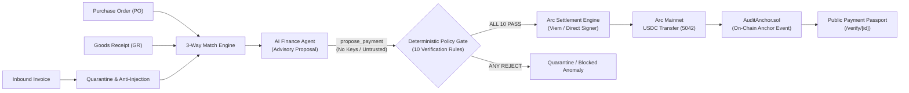

# BizFlow Pilot V2

> **The autonomous financial operations engine that turns real enterprise activity into policy-approved USDC payments on Arc Mainnet.**  
> Built with an air-gapped architecture where AI proposes, deterministic code decides, and keys are never touched by LLMs.  
> Every settlement anchors an immutable SHA-256 cryptographic audit trail to `AuditAnchor.sol` on Arc.

Built for the **Tameion Agents Hackathon (Canteen x Circle x Arc)** — October 2026.  
Upgraded from the original [BizFlow Pilot (Arc Microgrants edition)](https://github.com/iamoracle/bizflow-pilot).

### What V2 Adds:
1. **Autonomous Agent Loop**: Configurable autonomous mode with strict spend caps (`AUTO_APPROVE_LIMIT_USDC`, `MAX_DAILY_AUTONOMOUS_USDC`), daily cron execution, and real-time safety gating.
2. **Agent Decisions Log & Real Metrics**: Full audit trail of AI agent choices (`pay_now`, `schedule`, `hold`, `escalate`), model versioning, snapshot hashes, and honest metrics.
3. **Escalation Queue & Human Agreement Rate**: Transparent review flow where owner approvals feed into measurable human-agent agreement metrics.
4. **Payment Timing Intelligence**: Dynamic evaluation of early-pay discounts (e.g. 2/10 net 30) against cash reserves and obligations.
5. **Pilot Organizations & Consent Registry**: Multi-tenant pilot business support with verified proof links, builder-operated treasury declarations, and public consent.
6. **Circle Wallets & Sandbox Integration**: Dual deployment modes with testnet sandbox powered by Circle Developer-Controlled Wallets (`ARC-TESTNET`).
7. **Arc App Kit Send & Paris EVM PolicyVault**: Extensible settlement providers and on-chain budget contracts.

[](LICENSE)
[](https://www.typescriptlang.org/)
[](https://nextjs.org/)
[](https://explorer.arc.io)

---

## Live Deployment & Real Arc Mainnet Artifacts

- **Live Application:** [https://bizflow-pilot.vercel.app](https://bizflow-pilot.vercel.app) *(or your deployed production URL)*
- **Interactive Judge Guide:** Open `/judges` directly on the site for a 5-minute evaluation walkthrough.
- **Target Blockchain:** **Arc Mainnet (Chain ID `5042`)**
- **Native Gas Asset:** USDC (18 decimals native gas token)
- **Settlement Asset:** USDC (EVM token on Arc)
- **Real Settlement Transaction (0.50 USDC):**
  - **Tx Hash:** [`0x9f5a7d65b758269d6c42939b4cb0e7e17eaec596b42b6559d2824dfb5dbd0e82`](https://explorer.arc.io/tx/0x9f5a7d65b758269d6c42939b4cb0e7e17eaec596b42b6559d2824dfb5dbd0e82)
  - **Live Verification Passport:** Open `/verify/inv-mainnet-101` (or click "Public Passport" on the Command Center)
- **Deployed AuditAnchor Contract:**
  - **Address:** [`0x2b18fe9d3a63710da242092571744520ea8effe0`](https://explorer.arc.io/address/0x2b18fe9d3a63710da242092571744520ea8effe0)
  - **Anchor Tx:** [`0x600e31431faba6022dbc5d259961ddc4fbd89e7c2867b1e590ca76f8d74b83e4`](https://explorer.arc.io/tx/0x600e31431faba6022dbc5d259961ddc4fbd89e7c2867b1e590ca76f8d74b83e4)
  - **Block Height:** `25822380`

---

<!-- ADDRESSES_PROOF_START -->
### Addresses and Proof

| Entity / Contract | Address / Identifier | Network | Explorer Link |
|---|---|---|---|
| **Builder-Operated Treasury** | `0x061F5c70D68A246b654724C0f9595F3a14cF9b0B` | Arc Mainnet (`5042`) | [View Treasury on Arc Explorer](https://explorer.arc.io/address/0x061F5c70D68A246b654724C0f9595F3a14cF9b0B) |
| **Audit Anchor Contract** | `0xf277e351656699c2a0e1a0d9e4ecb5e786916ba9` | Arc Mainnet (`5042`) | [View Audit Anchor Contract](https://explorer.arc.io/address/0xf277e351656699c2a0e1a0d9e4ecb5e786916ba9) |
| **Native USDC System Contract** | `0x3600000000000000000000000000000000000000` | Arc Mainnet (`5042`) | [View USDC Contract](https://explorer.arc.io/address/0x3600000000000000000000000000000000000000) |
| **Active Verified Vendor (Dangote Cement Distribution (demo))** | `0x70997970C51812dc3A010C7d01b50e0d17dc79C8` | Arc Mainnet (`5042`) | [View Vendor Wallet](https://explorer.arc.io/address/0x70997970C51812dc3A010C7d01b50e0d17dc79C8) |
<!-- ADDRESSES_PROOF_END -->

---

## End-to-End Pipeline Architecture



### The Trust Model: Untrusted AI vs. Deterministic Code

| Dimension | AI Advisory Layer | Deterministic Policy Gate |
|---|---|---|
| **Authority** | **Proposal only**. Has zero transaction rights. | **Final gatekeeper**. Evaluates 10 hardcoded rules. |
| **Private Keys** | **Never exposed**. AI code runs in isolated sandbox. | **Server-side only**. Signed via isolated Viem signer. |
| **Prompt Injection** | Quarantined via regex and schema parsing. | Neutralized: Policy requires matching verified whitelist. |
| **Execution** | Suggests approval or flagging with rationale. | Code validates balance, reserve floor, and limits. |
| **Auditability** | Reasoned excerpt captured into decision payload. | Output hashed into immutable SHA-256 block chain. |

---

## 10-Point Deterministic Policy Guardrails

Every payment must pass all 10 deterministic server-side rules before any signer is invoked:

1. **Active Whitelisted Vendor:** Beneficiary must be registered with active status.
2. **Wallet Authenticity:** Destination wallet must match vendor record with no pending address cooldowns.
3. **Price Tolerance:** Invoiced unit price must match approved PO within 1.00% (100 bps).
4. **Quantity Reconciliation:** Invoiced quantity cannot exceed goods receipt note count.
5. **Zero-Day Duplicate Hash Screen:** SHA-256 invoice content hash must be unique across all time.
6. **Prompt-Injection Defense:** Text payloads scanned and quarantined for adversarial prompt injection strings.
7. **Single Transaction Spending Cap:** Individual payment must not exceed configured cap (1.00 USDC on Mainnet).
8. **Daily Treasury Volume Limit:** Cumulative 24-hour volume cannot exceed governance ceiling.
9. **Treasury Reserve Floor:** Settlement must preserve safe gas and operational reserve balances.
10. **Governance Emergency Kill-Switch:** Master emergency halt switch must be in disarmed state.

---

## Public Review Endpoints (No Login Required)

BizFlow Pilot is built for frictionless 5-minute hackathon evaluation:

- **`/`**: Command Center with Live Proof banner, real-time Arc RPC treasury balances, and active policy status.
- **`/judges`**: Dedicated Judge Guide with hackathon compliance table, direct links, and transparency disclosure.
- **`/invoices`**: Live matching desk demonstrating golden path, blocked duplicate, quantity mismatch, and prompt injection attack.
- **`/payments`**: Payment desk with idempotent settlement queue, dry-run indicator, and passcode protection.
- **`/verify/[id]`**: Public Payment Passport with live Arc RPC receipt verification, gas consumption, and 10-rule certificate.
- **`/audit`**: Append-only cryptographic ledger with in-browser "Verify Chain" re-hashing.
- **`/simulator`**: Interactive governance simulator to test edge cases, tolerance violations, and kill-switch halts.
- **`GET /api/proof`**: Public JSON endpoint returning latest confirmed settlement, anchor tx, and explorer links (cached 30s).
- **`GET /api/health`**: Automated diagnostics reporting database health, RPC chain ID validation, and contract deployment in under 2 seconds.

---

## Running Locally

### Prerequisites
- Node.js 18+ (tested on Node 20 LTS)
- PowerShell (Windows) or bash (macOS/Linux)
- Git

### 1. Installation
```bash
git clone https://github.com/iamoracle/bizflow-pilot.git
cd bizflow-pilot
npm install
```

### 2. Database Initialization
```bash
npx prisma generate
npx prisma db push
npm run db:seed
```

### 3. Running Development Server
```bash
# Start dev server on port 3001 (testnet mode)
npm run dev

# Or run with testnet environment variables:
npm run dev:testnet

# Or run with mainnet configuration:
npm run dev:mainnet
```
Visit [http://localhost:3001](http://localhost:3001) in your browser.

### 4. Running Test Suites
```bash
# Unit & integration tests (Vitest)
npm test

# Production build check
npm run build
```

---

## Environment Variables Reference

*(Secrets and keys are never rendered in client HTML, logged, or checked into version control.)*

| Variable | Description | Exposed to Client? |
|---|---|---|
| `NEXT_PUBLIC_NETWORK_MODE` | Target environment: `"testnet"` or `"mainnet"` | Yes |
| `NEXT_PUBLIC_APP_URL` | Base application URL (default: `http://localhost:3001`) | Yes |
| `NEXT_PUBLIC_REPO_URL` | Public GitHub repository URL | Yes |
| `NEXT_PUBLIC_BUILDER_PROFILE_URL` | Builder social / GitHub profile URL | Yes |
| `NEXT_PUBLIC_AUDIT_ANCHOR_ADDRESS` | Deployed `AuditAnchor.sol` contract address | Yes |
| `DATABASE_URL` | PostgreSQL or local SQLite connection string | **No (Server-Only)** |
| `DIRECT_URL` | Direct connection string for PostgreSQL / Supabase | **No (Server-Only)** |
| `DB_TIMEOUT_MS` | Prisma query timeout in milliseconds (default: `15000`) | **No (Server-Only)** |
| `OWNER_PASSCODE` | Mainnet execution passcode for settlement & kill-switch | **No (Server-Only)** |
| `TREASURY_PRIVATE_KEY` | EOA treasury signer key on Arc (DirectEvmProvider) | **No (Server-Only)** |
| `ARC_MAINNET_RPC_URL` | Primary Arc Mainnet RPC (default: `https://rpc.mainnet.arc.io`) | **No (Server-Only)** |
| `ARC_MAINNET_EXPLORER_URL` | Arc Mainnet Explorer base URL | **No (Server-Only)** |
| `PAYMENT_PROVIDER` | Settlement adapter: `"direct"` or `"circle"` | **No (Server-Only)** |
| `MAX_MAINNET_PAYMENT_USDC` | Safety ceiling per transaction (default: `1.00`) | **No (Server-Only)** |

---

## Transparent Disclosure & Limitations

1. **PoC Scope:** BizFlow Pilot is an architectural proof-of-concept demonstrating autonomous 3-way matching, AI air-gapping, deterministic policy gating, Arc USDC settlement, and on-chain audit anchoring.
2. **Demo-Scale Amounts:** To safely operate on live Arc Mainnet, all transaction amounts are capped at 1.00 USDC (the golden path demo payment settles 0.50 USDC).
3. **Fictional Counterparties:** While the on-chain transactions and contract deployments are 100% real, vendor names (e.g. *Northgate Cement Supply*) and warehouse receiving logs are fictionalized demo scenarios to safeguard enterprise confidentiality.
4. **Owner Passcode:** Visitor sessions are strictly read-only to prevent unauthorized treasury outflow. Live transactions require the owner passcode.

---

## License

This project is licensed under the [MIT License](LICENSE) — free and open source.
